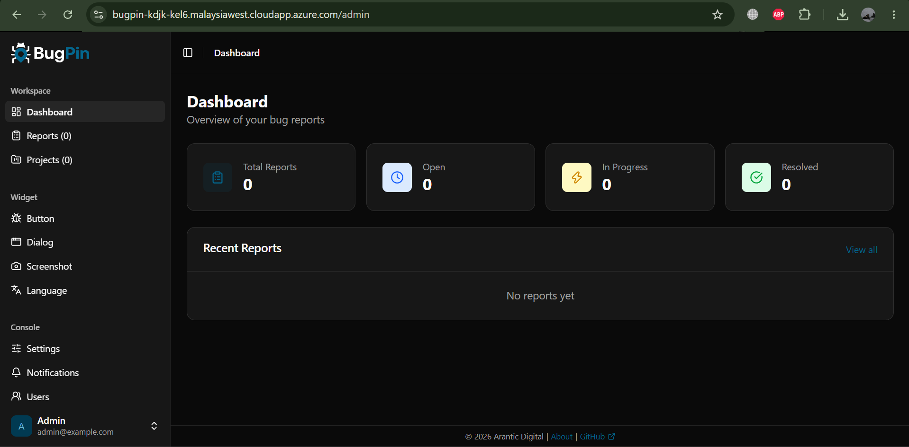

# Aplikasi Web "BugPin"

<h1 align="center"></h1>

<div align="center">
<strong>Kelompok 6 Komunikasi Data dan Jaringan Paralel 2</strong>

| No | Nama | NIM |
|:--:|:--:|:--:|
| 1 | Anisa Nur Rohmah | M0403241035 |
| 2 | Dhikral Baihaqi | M0403241168 |
| 3 | Suryani Prayudia H. | M0403241063 |
| 4 | Nabil Musannif Siregar | M0403241121 |
| 5 | Nugraheni Dwi Ayu P. | M0403241012 |
</div>

<table>
  <tr>
    <td align="center"><a href="#sekilas-tentang"><b>Sekilas Tentang</b></a></td>
    <td align="center"><a href="#instalasi"><b>Instalasi</b></a></td>
    <td align="center"><a href="#konfigurasi"><b>Konfigurasi</b></a></td>
    <td align="center"><a href="#otomatisasi"><b>Otomatisasi</b></a></td>
    <td align="center"><a href="#cara-pemakaian"><b>Cara Pemakaian</b></a></td>
    <td align="center"><a href="#pembahasan"><b>Pembahasan</b></a></td>
    <td align="center"><a href="#referensi"><b>Referensi</b></a></td>
  </tr>
</table>

## Sekilas Tentang

[`^ kembali ke atas ^`](#aplikasi-web-bugpin)

**BugPin** adalah aplikasi web pelaporan bug visual (*visual bug reporting*) yang dapat dipasang di server sendiri. Pengguna dapat mengambil tangkapan layar (*screenshot*) langsung dari halaman web, menandai bagian yang bermasalah dengan alat gambar seperti pena, kotak, lingkaran, panah, teks, dan *blur* untuk menyamarkan data sensitif, lalu mengirimkannya sebagai laporan. Tim pengembang kemudian dapat mengelola laporan yang masuk, membagikannya ke anggota tim (*assignment*), dan meneruskannya ke *GitHub Issues* atau notifikasi email.

BugPin bersifat *Open Source* dan kode sumbernya tersedia di [GitHub](https://github.com/aranticlabs/bugpin). Dokumentasi resminya dapat dibaca di [docs.bugpin.io](https://docs.bugpin.io/). Aplikasi ini dibangun dengan `Bun` dan `Hono` pada sisi server, `React` untuk *admin console*, serta `Preact` dan `Fabric.js` untuk *widget* pelapornya. Seluruh data disimpan di `SQLite`. BugPin dirancang sebagai alternatif *self-hosted* dari layanan berbayar seperti Marker.io, BugHerd, dan Usersnap, sehingga seluruh data laporan tetap berada di infrastruktur kita sendiri.

*Widget* BugPin ditanam ke website cukup dengan satu *script tag*, menggunakan *Shadow DOM* agar tampilannya tidak bentrok dengan website, dan dapat menyimpan laporan sementara saat *offline* lalu mengirimkannya otomatis ketika koneksi kembali. Widget ini bisa dipakai di berbagai *framework* seperti React, Vue, Angular, maupun HTML biasa.

Pada dokumentasi ini, BugPin dipasang di sebuah **Virtual Machine Microsoft Azure** (region *Malaysia West*) dengan **Docker**, dan diakses lewat internet menggunakan **HTTPS**. Hasil instalasi dapat diakses di [bugpin-kdjk-kel6.malaysiawest.cloudapp.azure.com](https://bugpin-kdjk-kel6.malaysiawest.cloudapp.azure.com/), yang menampilkan halaman *BugPin Admin* sebagai pintu masuk ke dashboard pengelolaan laporan.

Arsitektur sederhananya:

```
Browser --HTTPS--> [Reverse Proxy] --> BugPin server (Bun + Hono) --> SQLite
                   \______________ semuanya berjalan sebagai container Docker ______________/
```

## Instalasi

[`^ kembali ke atas ^`](#aplikasi-web-bugpin)

**Kebutuhan Sistem :**

- Virtual Machine dengan Ubuntu Server 24.04 LTS (64-bit).
- Spesifikasi minimal 1 vCPU dan 512 MB RAM, disarankan 2 vCPU dan 1 GB RAM atau lebih.
- Ruang disk minimal 30 GB.
- Akses SSH ke server (menggunakan SSH key).
- Port `22` (SSH), `80` (HTTP), dan `443` (HTTPS) terbuka pada firewall / *Network Security Group*. Port `22` sebaiknya dibatasi hanya untuk IP administrator. Port `7300` milik BugPin tidak perlu dibuka karena hanya diakses dari dalam server.
- Nama domain atau DNS yang mengarah ke IP server. Pada percobaan ini digunakan DNS gratis dari Azure: `bugpin-kdjk-kel6.malaysiawest.cloudapp.azure.com`.
- Docker Engine dan Docker Compose plugin (dipasang pada langkah di bawah).

Komponen berikut digunakan pada instalasi ini:

- **BugPin server** (image resmi `registry.arantic.cloud/bugpin/bugpin:latest`) berjalan sebagai *container* Docker. Database `SQLite` dan file unggahan disimpan di folder `/opt/bugpin/data`.
- **Nginx** (*reverse proxy*) dipasang langsung di server untuk meneruskan lalu lintas dari port 80/443 ke BugPin.
- **Certbot** dipasang di server untuk membuat sertifikat HTTPS gratis dari Let's Encrypt.

**Proses Instalasi :**

1. Login ke dalam server menggunakan SSH. Ganti `<username>` dengan username VM (misalnya `azureuser`). Untuk pengguna Windows, perintah ini dapat dijalankan di WSL.

```bash
$ chmod 400 ~/.ssh/vm-bugpin_key.pem
$ ssh -i ~/.ssh/vm-bugpin_key.pem <username>@bugpin-kdjk-kel6.malaysiawest.cloudapp.azure.com
```

2. Pasang Docker Engine dan Docker Compose plugin dari repository resmi Docker. Jalankan seluruh perintah berikut secara berurutan.

```bash
sudo apt update

sudo apt install -y ca-certificates curl

sudo install -m 0755 -d /etc/apt/keyrings

sudo curl -fsSL https://download.docker.com/linux/ubuntu/gpg -o /etc/apt/keyrings/docker.asc

sudo chmod a+r /etc/apt/keyrings/docker.asc

sudo tee /etc/apt/sources.list.d/docker.sources <<EOF
Types: deb
URIs: https://download.docker.com/linux/ubuntu
Suites: $(. /etc/os-release && echo "${UBUNTU_CODENAME:-$VERSION_CODENAME}")
Components: stable
Architectures: $(dpkg --print-architecture)
Signed-By: /etc/apt/keyrings/docker.asc
EOF

sudo apt update

sudo apt install -y docker-ce docker-ce-cli containerd.io docker-buildx-plugin docker-compose-plugin

sudo systemctl enable --now docker
```

3. Uji instalasi Docker.

```bash
$ sudo docker run hello-world
$ sudo docker compose version
$ sudo systemctl status docker --no-pager
```

Docker berhasil terpasang jika `hello-world` menampilkan pesan sukses dan status Docker adalah `active (running)`.

4. Buat direktori kerja untuk BugPin beserta folder data. Folder data diberikan kepada UID/GID 1000 agar bisa ditulis oleh *container*.

```bash
$ sudo mkdir -p /opt/bugpin/data
$ sudo chown -R 1000:1000 /opt/bugpin/data
$ cd /opt/bugpin
```

5. Buat file `docker-compose.yml`.

```bash
$ sudo nano /opt/bugpin/docker-compose.yml
```

Isi file dengan konfigurasi berikut :

```yaml
services:
  bugpin:
    image: registry.arantic.cloud/bugpin/bugpin:latest
    container_name: bugpin
    restart: unless-stopped
    ports:
      - "127.0.0.1:7300:7300"
    volumes:
      - ./data:/data
    environment:
      - LOG_LEVEL=info
    healthcheck:
      test: ["CMD", "wget", "-q", "-O", "/dev/null", "http://localhost:7300/health"]
      interval: 30s
      timeout: 3s
      retries: 3
      start_period: 10s
```

Port `127.0.0.1:7300:7300` membuat BugPin hanya bisa diakses dari dalam server, sehingga seluruh akses dari internet harus melewati Nginx. Volume `./data:/data` menjaga agar data tidak hilang saat *container* dihapus atau diperbarui. Bagian `healthcheck` memeriksa secara berkala apakah BugPin masih merespons.

6. Jalankan BugPin, lalu periksa statusnya.

```bash
$ cd /opt/bugpin
$ sudo docker compose up -d
$ sudo docker compose ps
$ sudo docker compose logs --tail 100 bugpin
$ curl -i http://127.0.0.1:7300/health
```

Pastikan *container* `bugpin` berstatus `running` dan endpoint `/health` memberi respons.

7. Pasang Nginx.

```bash
$ sudo apt update
$ sudo apt install -y nginx
$ sudo systemctl enable --now nginx
```

8. Buat file konfigurasi Nginx untuk meneruskan lalu lintas ke BugPin.

```bash
$ sudo nano /etc/nginx/sites-available/bugpin
```

```nginx
server {
    listen 80;
    server_name bugpin-kdjk-kel6.malaysiawest.cloudapp.azure.com;

    client_max_body_size 10M;

    location / {
        proxy_pass http://127.0.0.1:7300;
        proxy_http_version 1.1;

        proxy_set_header Host $host;
        proxy_set_header X-Real-IP $remote_addr;
        proxy_set_header X-Forwarded-For $proxy_add_x_forwarded_for;
        proxy_set_header X-Forwarded-Proto $scheme;
    }
}
```

9. Aktifkan konfigurasi, uji sintaksnya, lalu muat ulang Nginx.

```bash
$ sudo ln -s /etc/nginx/sites-available/bugpin /etc/nginx/sites-enabled/bugpin
$ sudo rm -f /etc/nginx/sites-enabled/default
$ sudo nginx -t
$ sudo systemctl reload nginx
```

10. Pasang Certbot dan aktifkan HTTPS. Ikuti pertanyaan yang muncul (isi email, setujui ketentuan, lalu pilih *redirect* HTTP ke HTTPS).

```bash
$ sudo apt update
$ sudo apt install -y certbot python3-certbot-nginx
$ sudo certbot --nginx -d bugpin-kdjk-kel6.malaysiawest.cloudapp.azure.com
$ sudo certbot renew --dry-run
```

11. Kunjungi alamat berikut pada browser, lalu login ke *Admin Console*.

```
https://bugpin-kdjk-kel6.malaysiawest.cloudapp.azure.com
```
Gunakan akun bawaan BugPin untuk login pertama kali:
| Email | Password |
|-------|----------|
| `admin@example.com` | `changeme123` |



## Konfigurasi

[`^ kembali ke atas ^`](#aplikasi-web-bugpin)

Menurut dokumentasi resminya, BugPin tidak membutuhkan *environment variable* untuk deployment umum. Pengaturan aplikasi dilakukan melalui **Admin Console** setelah login, sedangkan konfigurasi di sisi server hanya mencakup `docker-compose.yml` (menjalankan BugPin) dan Nginx (akses dari internet). Setiap perubahan pada `docker-compose.yml` harus diterapkan dengan `sudo docker compose up -d` dari folder `/opt/bugpin`. Perubahan pada Nginx diterapkan dengan `sudo nginx -t` untuk memeriksa sintaks, lalu `sudo systemctl reload nginx`.

| Pengaturan | Fungsi |
|------------|--------|
| `LOG_LEVEL=info` | Tingkat detail log aplikasi. Log dapat dilihat dengan `sudo docker compose logs bugpin` |
| `127.0.0.1:7300:7300` | Port bawaan BugPin adalah `7300`. Dengan diikat ke `127.0.0.1`, port ini hanya bisa diakses dari dalam server, sehingga seluruh akses dari internet harus melewati Nginx |
| `./data:/data` | Volume penyimpanan. Database SQLite, kunci sesi, dan seluruh file unggahan (*screenshot*, lampiran, logo) tersimpan di `/opt/bugpin/data`, sehingga data tidak hilang saat *container* dihapus atau diperbarui |
| `healthcheck` | Memeriksa endpoint `/health` setiap 30 detik. Statusnya dapat dilihat dengan `sudo docker inspect --format='{{.State.Health.Status}}' bugpin` |
| `proxy_pass` (Nginx) | Meneruskan permintaan dari Nginx ke BugPin di `http://127.0.0.1:7300` |
| `client_max_body_size 10M` (Nginx) | Batas ukuran unggahan. Dokumentasi BugPin menyarankan minimal 10 MB agar *screenshot* dan lampiran laporan tidak ditolak |

Pengaturan pada Admin Console (dilakukan setelah login) :
- **Settings** : alamat aplikasi, lokasi penyimpanan unggahan (lokal atau S3), dan pengaturan SMTP untuk email notifikasi.
- **Security** : batas permintaan per menit (*rate limiting*) dan lama sesi login.
- **Projects** : daftar domain yang diizinkan memuat *widget* (*domain whitelist*) dan integrasi GitHub Issues untuk setiap project.
- **Widget, Branding, dan Users** : tampilan dan bahasa *widget*, logo serta warna, dan pengelolaan pengguna beserta perannya.

Pengaturan jaringan pada Azure :
- Port `22` (SSH), `80` (HTTP), dan `443` (HTTPS) dibuka pada *Network Security Group*. Port `22` sebaiknya dibatasi hanya untuk IP administrator.
- Alamat IP publik diberi **DNS name label**, sehingga server dapat diakses lewat `bugpin-kdjk-kel6.malaysiawest.cloudapp.azure.com`. Disarankan juga mengatur IP publik menjadi **Static** agar alamat server tidak berubah.
- Port `7300` (BugPin) **sengaja tidak dibuka**. Hanya Nginx yang dapat diakses dari internet.

Pengaturan HTTPS dan Nginx :
- HTTPS wajib aktif. Sertifikat dibuat oleh Certbot dari Let's Encrypt, dipasang otomatis pada konfigurasi Nginx, dan diperpanjang otomatis. Perpanjangan dapat diuji dengan `sudo certbot renew --dry-run`.
- BugPin sudah mengatur header CORS (`Access-Control-Allow-Origin: *` dan `Cross-Origin-Resource-Policy: cross-origin`) agar *widget* dapat dimuat di website lain. Jangan menghapus atau menimpa header ini di Nginx, karena *widget* tidak akan muncul jika header tersebut hilang. Pengecekannya dengan `curl -I https://bugpin-kdjk-kel6.malaysiawest.cloudapp.azure.com/widget.js`.
- BugPin tidak memakai WebSocket, sehingga *proxy* HTTP/HTTPS biasa sudah cukup.

Catatan : akun bawaan BugPin (`admin@example.com`) memakai password yang tertulis pada dokumentasi publik. Segera ganti password setelah login pertama melalui menu *Profile* atau *Users*, dan simpan di tempat yang aman.
## Otomatisasi

[`^ kembali ke atas ^`](#aplikasi-web-bugpin)


## Cara Pemakaian

[`^ kembali ke atas ^`](#aplikasi-web-bugpin)


## Pembahasan

[`^ kembali ke atas ^`](#aplikasi-web-bugpin)


## Referensi

[`^ kembali ke atas ^`](#aplikasi-web-bugpin)

1. [aranticlabs/bugpin](https://github.com/aranticlabs/bugpin) - GitHub
2. [BugPin: Self-Hosted Visual Bug Reporting for Web Apps](https://docs.bugpin.io/) - BugPin Documentation
3. [Quick Start Guide](https://docs.bugpin.io/quickstart) - BugPin Documentation
4. [Docker Installation Guide](https://docs.bugpin.io/installation/docker) - BugPin Documentation
5. [Server Configuration Guide](https://docs.bugpin.io/configuration/server) - BugPin Documentation
6. [Reverse Proxy Setup Guide](https://docs.bugpin.io/installation/reverse-proxy) - BugPin Documentation
7. [Widget Installation Guide](https://docs.bugpin.io/widget/installation) - BugPin Documentation
8. [Install Docker Engine on Ubuntu](https://docs.docker.com/engine/install/ubuntu/) - Docker Docs
9. [Nginx Documentation](https://nginx.org/en/docs/) - Nginx
10. [Certbot](https://certbot.eff.org/) - Electronic Frontier Foundation
11. [Quickstart: Create a Linux VM in the Azure Portal](https://learn.microsoft.com/en-us/azure/virtual-machines/linux/quick-create-portal) - Microsoft Learn
12. [Network Security Groups Overview](https://learn.microsoft.com/en-us/azure/virtual-network/network-security-groups-overview) - Microsoft Learn
13. [Azure for Students](https://azure.microsoft.com/en-us/free/students) - Microsoft Azure

14. [Bugpin](https://bugpin-kdjk-kel6.malaysiawest.cloudapp.azure.com/) - Bugpin yang dimodifikasi kelompok kami